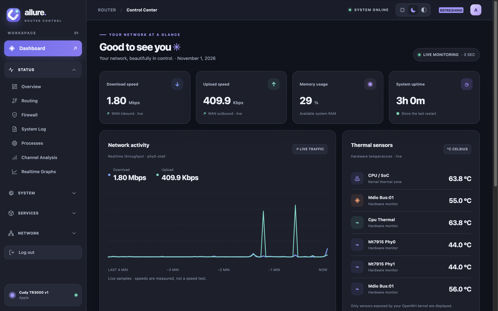
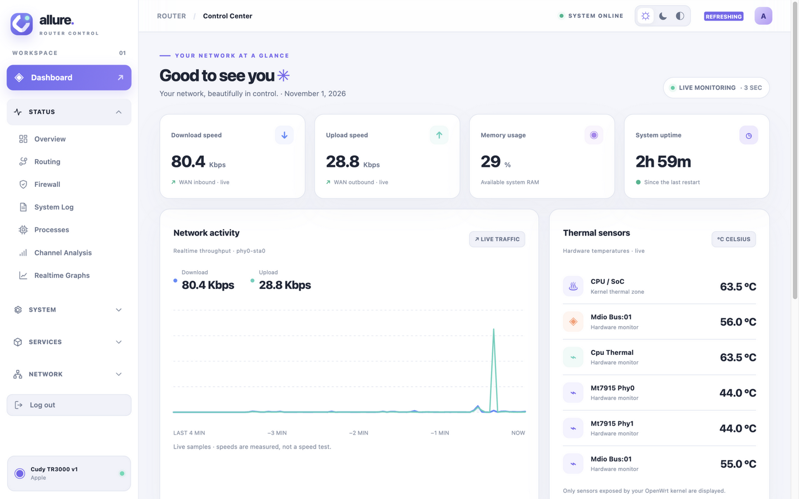
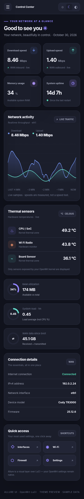

<p align="center">
  <picture>
    <source media="(prefers-color-scheme: dark)" srcset="allure-logo.svg">
    
  </picture>
</p>

<p align="center"><b>macOS-inspired LuCI theme for OpenWrt 25.x.</b><br>
Soft glass panels · translucent top bar · sidebar navigation · accent charts · light / dark / auto</p>

<p align="center">
  <b>English</b> · <a href="README_RU.md">Русский</a>
</p>

<p align="center">
  <a href="https://github.com/xCodeOn/OpenWRT-Theme-Allure/releases/latest"></a>
  <a href="LICENSE"></a>
  <a href="https://github.com/xCodeOn/OpenWRT-Theme-Allure/actions/workflows/build.yml"></a>
  
  <a href="https://github.com/xCodeOn/OpenWRT-Theme-Allure/stargazers"></a>
</p>

<p align="center">
  <a href="https://pay.cloudtips.ru/p/22326183"></a>
</p>

<p align="center">
  
</p>
<p align="center"><i>Status → Allure Dashboard — real traffic graphs, memory, load and sensors.</i></p>

## Screenshots

<p align="center">
  <a href="preview/screenshots/Allure_Dark_Screenshot.png"></a>
  <a href="preview/screenshots/Allure_Light_Screenshot.png"></a>
  <a href="preview/screenshots/Allure_Mobile_Screenshot.png"></a>
</p>

## What you get

| | |
|---|---|
| **Native LuCI** | Forms, network, wireless, firewall and every installed app — no router configuration is replaced |
| **Dashboard** | Status → Allure Dashboard; real download/upload graphs (every 3 s), WAN status, RAM, load, uptime, traffic |
| **Sensors** | Temperatures only from real thermal/hwmon sensors (`/sys/class/thermal`, `/sys/class/hwmon`) — never faked |
| **Themes** | Light / Dark / Auto, remembered per browser (`localStorage`) — including an animated login screen |
| **Navigation** | Sidebar with built-in SVG icons, collapsible sections, adaptive mobile panel |
| **Localization** | RU/EN follows LuCI language (auto-detects browser language) — Russian units and number formats |
| **Layout** | Global styling of forms, tables, tabs, modals and dropdowns; mobile-optimized cards and horizontal table scroll |
| **Privacy** | No CDN, third-party fonts, external libraries, trackers or background daemons |
| **Package** | Builds as `.apk` (OpenWrt 25.12+) and `.ipk` (opkg) — `all` architecture |

## Quick start

Wire the theme on an OpenWrt 25.12+ router (apk), e.g. Cudy TR3000:

```bash
wget -O /tmp/allure.apk https://github.com/xCodeOn/OpenWRT-Theme-Allure/releases/latest/download/luci-theme-allure-2.0.3-r1.apk
apk add --allow-untrusted /tmp/allure.apk

uci set luci.main.mediaurlbase='/luci-static/allure'
uci commit luci
rm -f /tmp/luci-indexcache
/etc/init.d/rpcd restart
/etc/init.d/uhttpd reload
```

Then reload the LuCI page without cache (Ctrl+Shift+R) — open **Status → Allure Dashboard**.

### Requirements

- **OpenWrt 25.12+** with the modern `ucode` LuCI (Cudy TR3000 v1 / Filogic MT7981 and similar).
- Dependencies (installed automatically by apk): `luci-base`, `luci-mod-status`, `luci-theme-bootstrap`, `rpcd-mod-ucode`.
- This is **not a firmware** — it installs on top of OpenWrt. Not for factory CudyOS or legacy Lua `.htm` themes.

## Installation

### From a release (`.ipk`, opkg / OpenWrt ≤ 23.05)

```sh
opkg update
opkg install luci-theme-allure_2.0.3_all.ipk
uci set luci.main.mediaurlbase='/luci-static/allure'
uci commit luci
rm -f /tmp/luci-indexcache
/etc/init.d/uhttpd reload
```

### From source

```sh
scp -r Allure_Router_OpenWrt25 root@192.168.1.1:/tmp/
# on the router
apk update
apk add luci-base luci-mod-status luci-theme-bootstrap rpcd-mod-ucode
cd /tmp/Allure_Router_OpenWrt25
sh install.sh
```

### Rollback

```sh
uci set luci.main.mediaurlbase='/luci-static/bootstrap'
uci commit luci
rm -f /tmp/luci-indexcache
/etc/init.d/uhttpd reload
```

## Building the package

Via the official OpenWrt buildroot / SDK (the same `Makefile` ships in `ci/luci-theme-allure/`):

```sh
cp -r Allure_Router_OpenWrt25 /path/to/openwrt/feeds/luci/themes/luci-theme-allure
make menuconfig   # LuCI → Themes → luci-theme-allure
make package/feeds/luci/luci-theme-allure/compile V=s
```

A GitHub Actions workflow (`.github/workflows/build.yml`) builds `.apk`/`.ipk` on every release automatically.

## Checks

```sh
ubus list luci.allure
ubus call luci.allure sensors
```

If `ubus list` does not show `luci.allure`, ensure `rpcd-mod-ucode` is installed and restart `/etc/init.d/rpcd`.

## Support the project

The theme is free and made in spare time. If it is useful to you, a star and a donation are the best thanks:

<p align="center">
  <a href="https://pay.cloudtips.ru/p/22326183"></a>
</p>

## License

[Apache-2.0](LICENSE).
